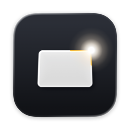
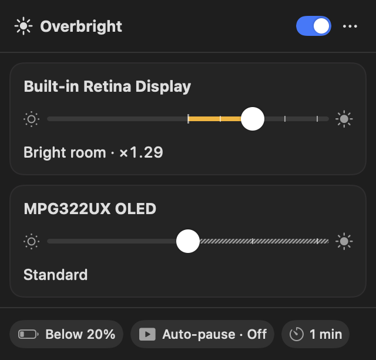
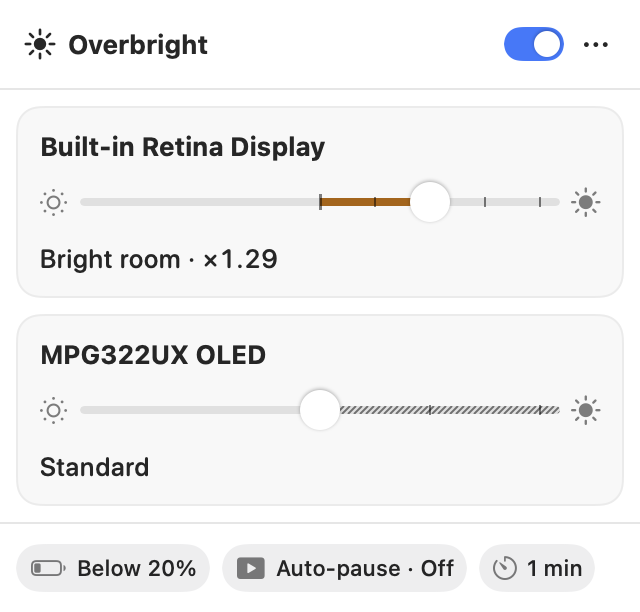
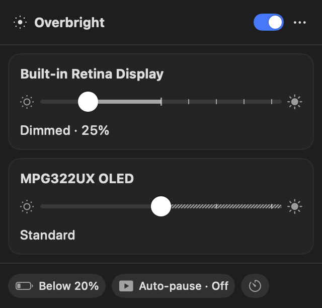
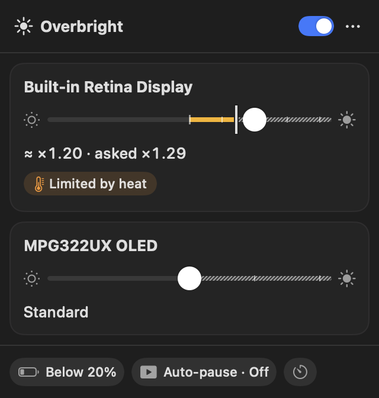
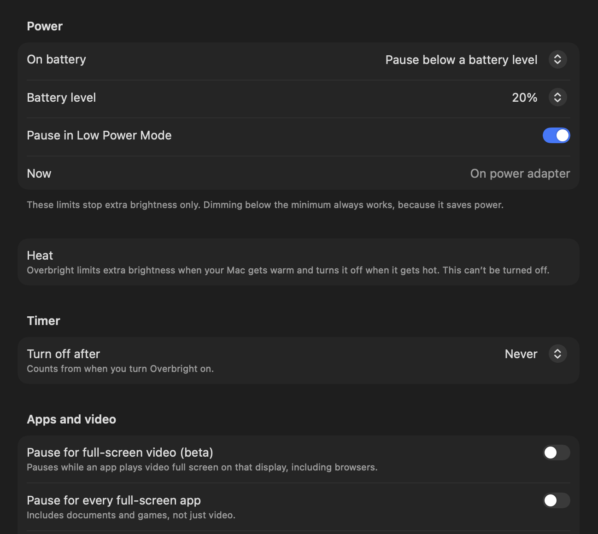
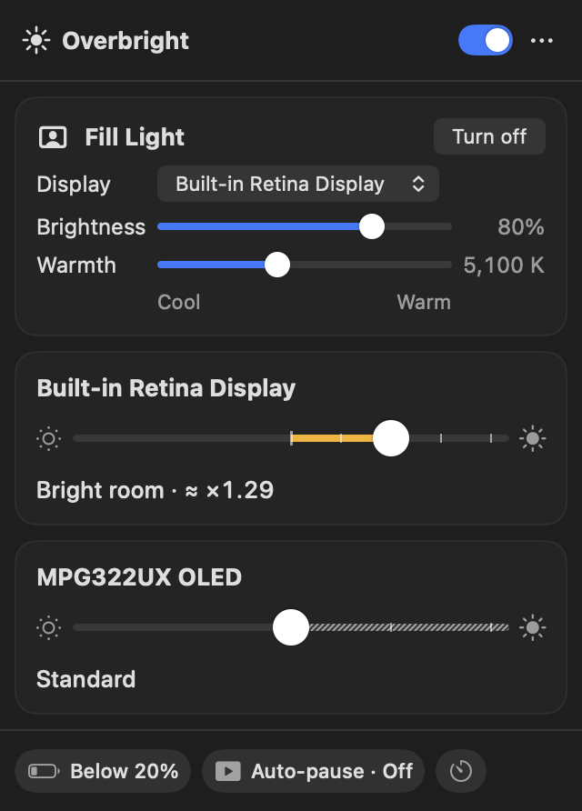
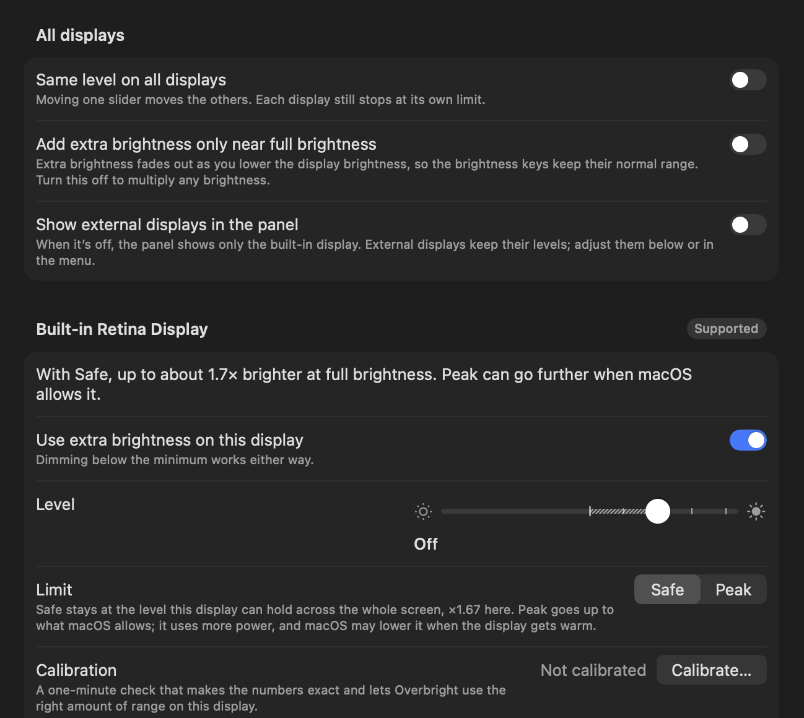
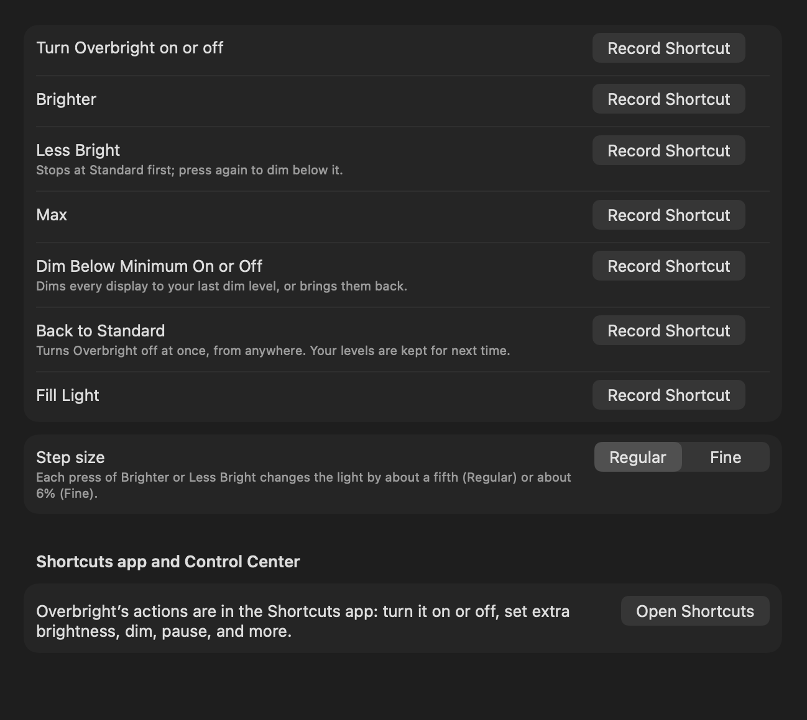
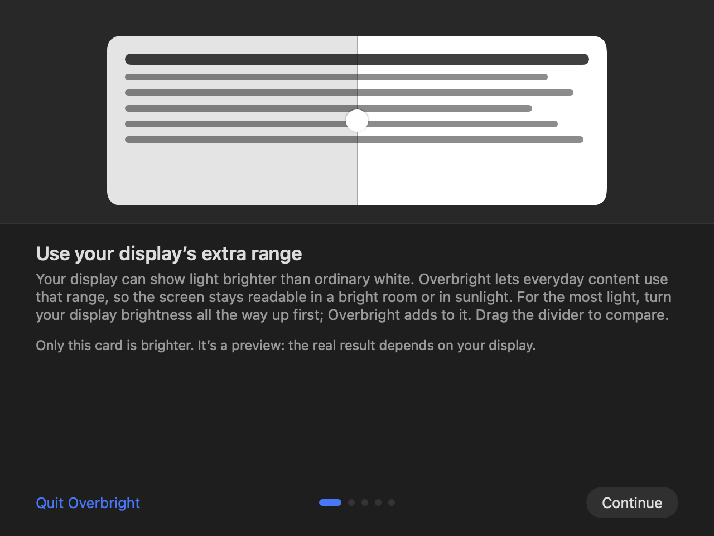

<p align="center">
  
</p>

<h1 align="center">Overbright</h1>

<p align="center">
  <b>Extra brightness for XDR and HDR displays on your Mac, and dimming below the macOS minimum.</b><br>
  A small menu bar app. Free and open source (MIT), no account, no analytics.
</p>

<p align="center">
  <b>English</b> · <a href="README.ru.md">Русский</a>
</p>

<p align="center">
  
  &nbsp;
  
</p>

## What it does

### ☀️ Brighter than the macOS maximum

The MacBook Pro's Liquid Retina XDR display, Apple's XDR displays and HDR monitors can show light brighter than
ordinary white, but macOS keeps that range for HDR video. Overbright lets everyday content use it, so the screen stays
readable in a bright room or in the sun. One slider per display: **right of Standard adds brightness**.

### 🌙 Darker than the macOS minimum

**Left of Standard dims** any display, HDR or not: handy at night. Dim All Displays can get its own shortcut.

<p align="center">
  
  &nbsp;
  
</p>

### 🛡️ Safe, and honest about every limit

- Starts **off**, with a **Safe** and a **Peak** ceiling; every change ramps smoothly, nothing flickers.
- Each change asks **“Keep this level?”** and goes back to Standard after 10 seconds if you don’t answer.
- Steps back on its own on battery, in Low Power Mode, when the Mac gets warm, and, if you want, for full-screen
  video, games, a timer or set hours. The panel always says **why** (“Limited by heat”).
- **Back to Standard** from anywhere: the panel switch, the menu, the Dock, the Shortcuts app or your own shortcut.

<p align="center">
  
</p>

### 💡 Fill Light for video calls

Lights your face on video calls with a glowing frame around the screen, warm or cool. Turn it on by hand or
whenever a camera is in use.

<p align="center">
  
</p>

### ⚙️ Per-display settings and calibration

Choose the level, the limit and whether a display uses extra brightness at all. A one-minute calibration makes
the numbers exact for your display.

<p align="center">
  
</p>

### ⌨️ Shortcuts and automation

Record your own keyboard shortcuts (none is set by default), and use Overbright’s actions in the **Shortcuts** app:
turn it on or off, set extra brightness, dim, pause, get the state. A Focus filter is included.

<p align="center">
  
</p>

### 👋 A friendly start

A short Welcome tour shows what your display can do: drag the divider to compare Standard with extra brightness.

<p align="center">
  
</p>

And also: full keyboard and VoiceOver support, **35 languages**, no permissions to grant.

## Install

Requires **macOS 14 Sonoma or later** (Apple silicon or Intel).

1. Download `Overbright-<version>.dmg` from [Releases](https://github.com/stansful/overbright-swift/releases).
2. Drag **Overbright** to **Applications** and open it. It lives in the menu bar.

If macOS says the app **can’t be opened**, click **Open Anyway** in System Settings ▸ Privacy & Security, or run:

```bash
xattr -dr com.apple.quarantine /Applications/Overbright.app
```

## If the screen looks wrong

Nothing to worry about, every way back is built in:

- Wait 10 seconds: an unconfirmed change goes back to Standard on its own.
- Turn Overbright off in the panel or the menu, or **Force Quit** it: macOS restores the displays at once.
- Or reset every display’s colors from Terminal:

```bash
/Applications/Overbright.app/Contents/MacOS/Overbright --restore-gamma
```

## Privacy

No analytics, no crash reporting, no account. Everything stays on your Mac. The only network request is an optional
update check against this repository’s Releases page, off until you turn it on.

## Build from source

You need **Xcode 27**.

```bash
make build
```

`make run` starts a Debug build with simulated displays, so it never changes your real screen; `make test` runs
the tests; `make help` lists the rest.

## More

- [docs/OVERVIEW.md](docs/OVERVIEW.md) — the full overview: safety and recovery, energy, privacy, languages, build
- [docs/CONTRIBUTING.md](docs/CONTRIBUTING.md) — how to contribute
- [docs/ARCHITECTURE.md](docs/ARCHITECTURE.md) and [docs/DESIGN.md](docs/DESIGN.md) — how it’s built and how it looks
- [docs/TRANSLATING.md](docs/TRANSLATING.md) — fix or review a translation

## License

MIT, see [LICENSE](LICENSE). Credits and third-party notices are in [THIRD_PARTY_NOTICES.md](THIRD_PARTY_NOTICES.md).
