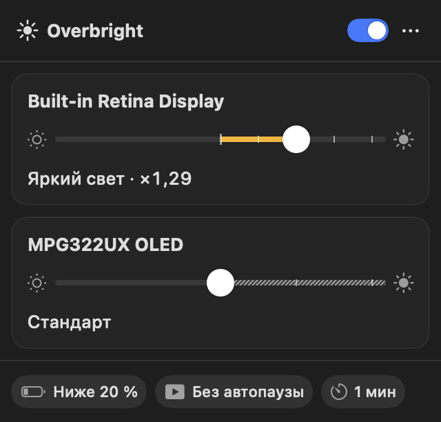
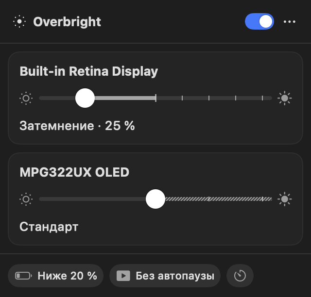
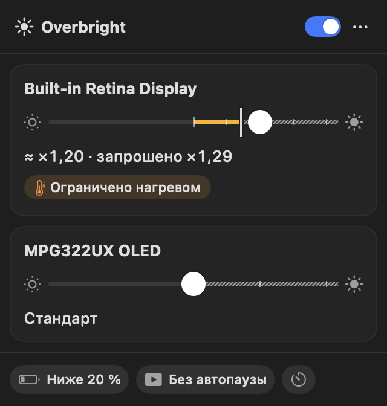
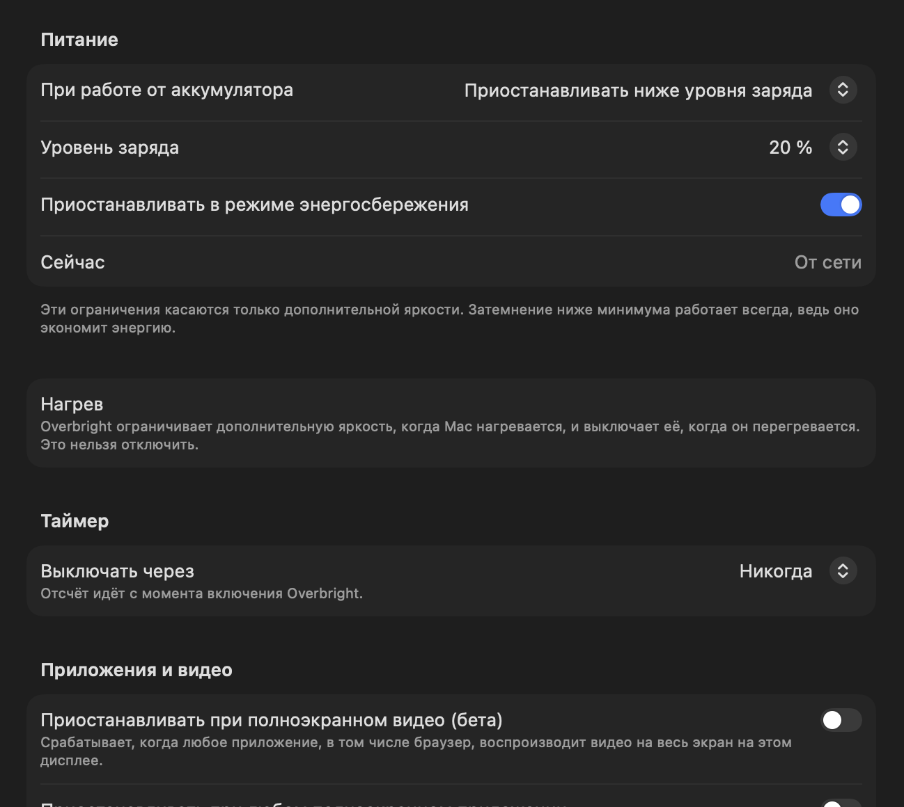
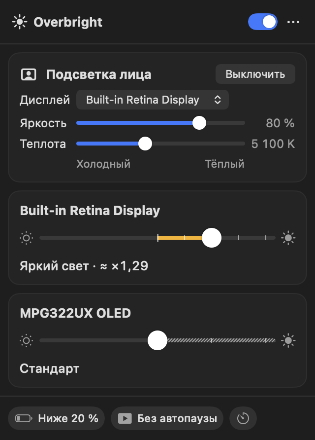
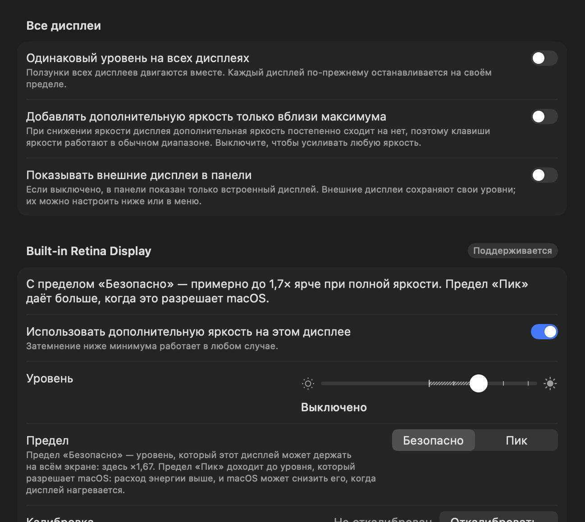
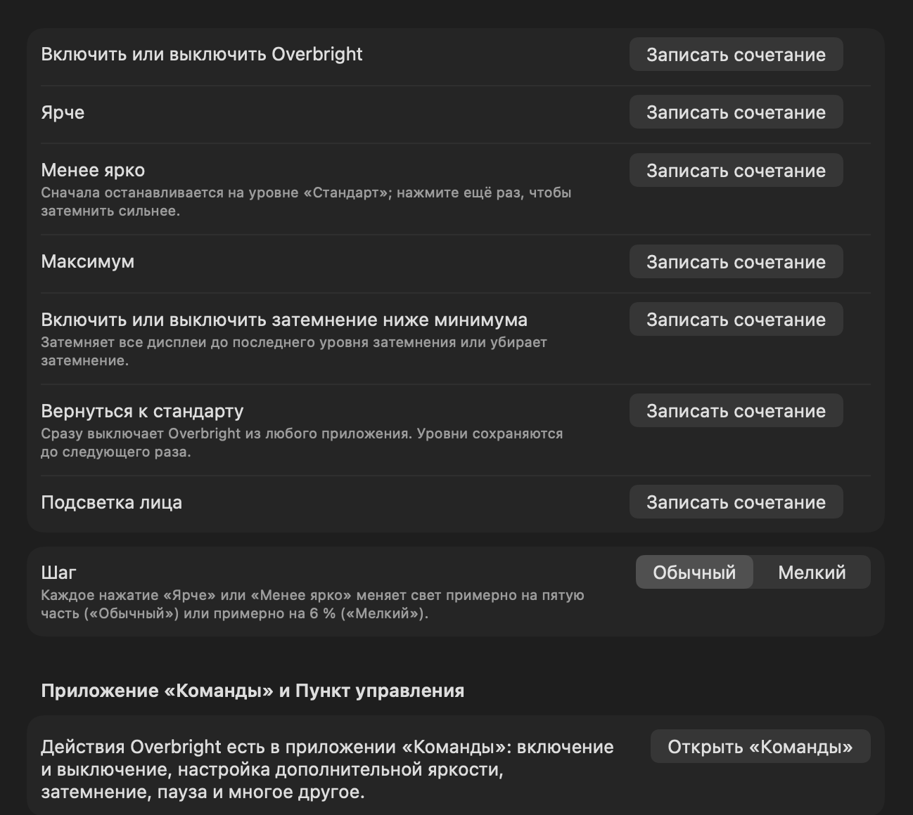
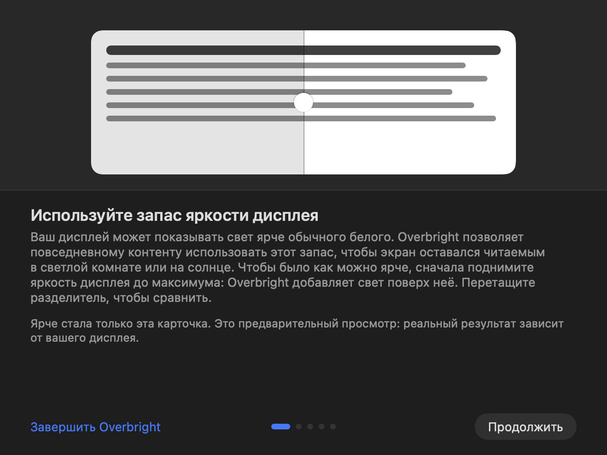

<p align="center">
  
</p>

<h1 align="center">Overbright</h1>

<p align="center">
  <b>Дополнительная яркость для XDR- и HDR-дисплеев Mac и затемнение ниже минимума macOS.</b><br>
  Небольшое приложение в строке меню. Бесплатно и с открытым кодом (MIT), без аккаунта и без аналитики.
</p>

<p align="center">
  <a href="README.md">English</a> · <b>Русский</b>
</p>

<p align="center">
  
</p>

## Что умеет

### ☀️ Ярче максимума macOS

Дисплей Liquid Retina XDR в MacBook Pro, XDR-дисплеи Apple и HDR-мониторы умеют показывать свет ярче обычного белого,
но macOS бережёт этот запас для HDR-видео. Overbright отдаёт его обычным окнам, и экран остаётся читаемым в светлой
комнате или на солнце. У каждого дисплея свой ползунок: **правее «Стандарта» — ярче**.

### 🌙 Темнее минимума macOS

**Левее «Стандарта» — темнее**, на любом дисплее, с HDR или без. Удобно ночью. Для «Затемнить все дисплеи» можно
назначить отдельное сочетание клавиш.

<p align="center">
  
  &nbsp;
  
</p>

### 🛡️ Безопасно и честно о каждом ограничении

- При запуске **выключен**; есть два предела — **«Безопасно»** и **«Пик»**; яркость меняется плавно, без
  мерцания.
- После каждого изменения Overbright спрашивает **«Оставить этот уровень?»** и через 10 секунд без ответа
  возвращается к «Стандарту».
- Сам уступает: от аккумулятора, в режиме энергосбережения, когда Mac нагревается, а по желанию — при
  полноэкранном видео, в играх, по таймеру или по расписанию. Панель всегда объясняет **почему**
  («Ограничено нагревом»).
- **«Вернуться к стандарту»** можно откуда угодно: переключатель на панели, меню, Dock, приложение «Быстрые команды»
  или своё сочетание клавиш.

<p align="center">
  
</p>

### 💡 Подсветка лица для видеозвонков

Освещает лицо во время звонка светящейся рамкой по краю экрана — тёплой или холодной. Включается вручную или
сама, когда работает камера.

<p align="center">
  
</p>

### ⚙️ Настройки для каждого дисплея и калибровка

Уровень, предел и то, нужна ли дисплею дополнительная яркость вообще. Калибровка за минуту делает цифры точными
для вашего дисплея.

<p align="center">
  
</p>

### ⌨️ Сочетания клавиш и «Быстрые команды»

Назначьте свои сочетания клавиш (по умолчанию их нет) и используйте действия Overbright в приложении
**«Быстрые команды»**: включить или выключить, задать яркость, затемнить, приостановить, узнать состояние.
Есть и фильтр режима фокусирования.

<p align="center">
  
</p>

### 👋 Понятное начало

Короткое знакомство показывает, на что способен ваш дисплей: потяните разделитель, чтобы сравнить «Стандарт»
с дополнительной яркостью.

<p align="center">
  
</p>

А ещё: полная поддержка клавиатуры и VoiceOver, **35 языков**, никаких разрешений выдавать не нужно.

## Установка

Нужна **macOS 14 Sonoma или новее** (Apple silicon или Intel).

1. Скачайте `Overbright-<версия>.dmg` со страницы [Releases](https://github.com/stansful/overbright-swift/releases).
2. Перетащите **Overbright** в **Программы** и откройте. Приложение живёт в строке меню.

Если macOS пишет, что приложение **не удаётся открыть**, нажмите **«Всё равно открыть»** в Системных настройках ▸
Конфиденциальность и безопасность или выполните:

```bash
xattr -dr com.apple.quarantine /Applications/Overbright.app
```

## Если с экраном что-то не так

Волноваться не о чем, все пути назад встроены:

- Подождите 10 секунд: неподтверждённое изменение откатится к «Стандарту» само.
- Выключите Overbright на панели или в меню либо **завершите принудительно** — macOS сразу восстановит дисплеи.
- Или сбросьте цвета всех дисплеев из Терминала:

```bash
/Applications/Overbright.app/Contents/MacOS/Overbright --restore-gamma
```

## Конфиденциальность

Ни аналитики, ни отчётов о сбоях, ни аккаунта. Всё остаётся на вашем Mac. Единственный сетевой запрос — проверка
обновлений на странице Releases этого репозитория, и она выключена, пока вы её не включите.

## Сборка из исходников

Нужен **Xcode 27**.

```bash
make build
```

`make run` запускает отладочную сборку с имитацией дисплеев — она никогда не меняет ваш настоящий экран;
`make test` запускает тесты; `make help` покажет остальное.

## Подробнее

- [docs/OVERVIEW.md](docs/OVERVIEW.md) — полное описание (на английском): безопасность и восстановление, энергия,
  конфиденциальность, языки, сборка
- [docs/CONTRIBUTING.md](docs/CONTRIBUTING.md) — как участвовать в разработке
- [docs/ARCHITECTURE.md](docs/ARCHITECTURE.md) и [docs/DESIGN.md](docs/DESIGN.md) — как устроено и как выглядит
- [docs/TRANSLATING.md](docs/TRANSLATING.md) — исправить или проверить перевод

## Лицензия

MIT, см. [LICENSE](LICENSE). Благодарности и сторонние уведомления — в [THIRD_PARTY_NOTICES.md](THIRD_PARTY_NOTICES.md).
